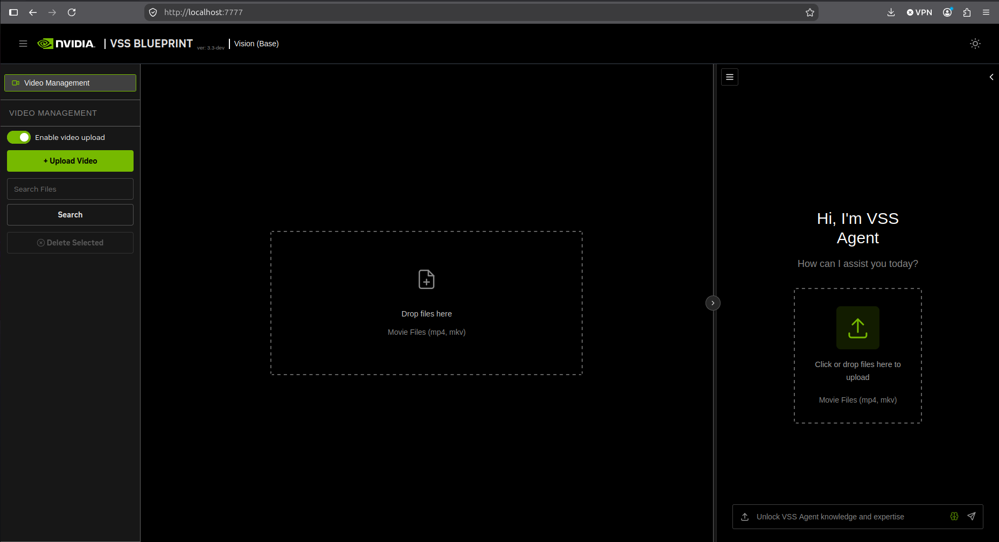
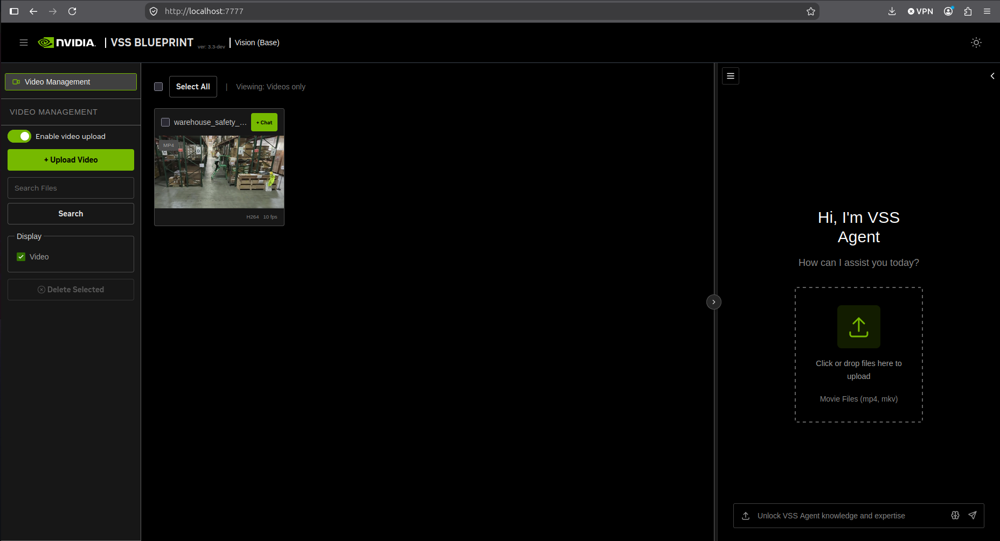
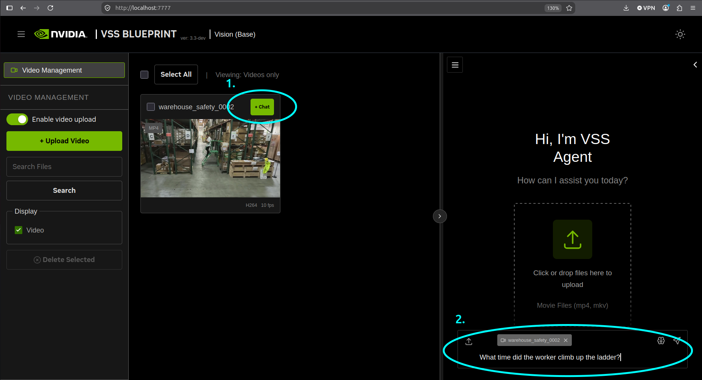
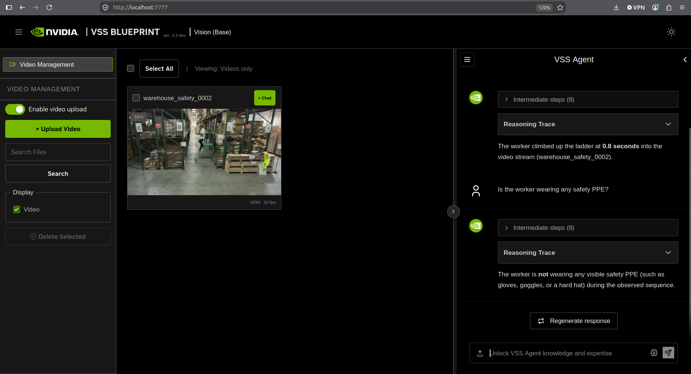
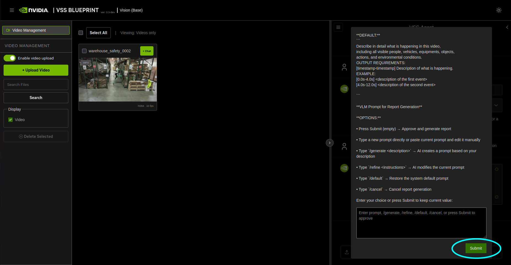
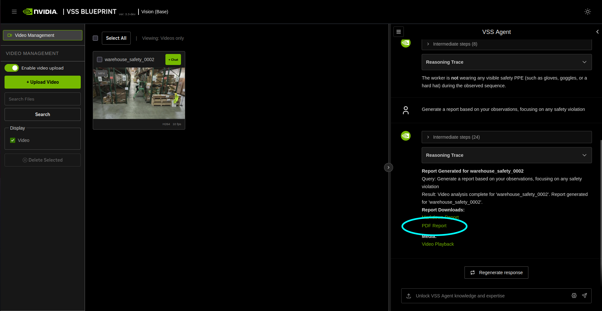
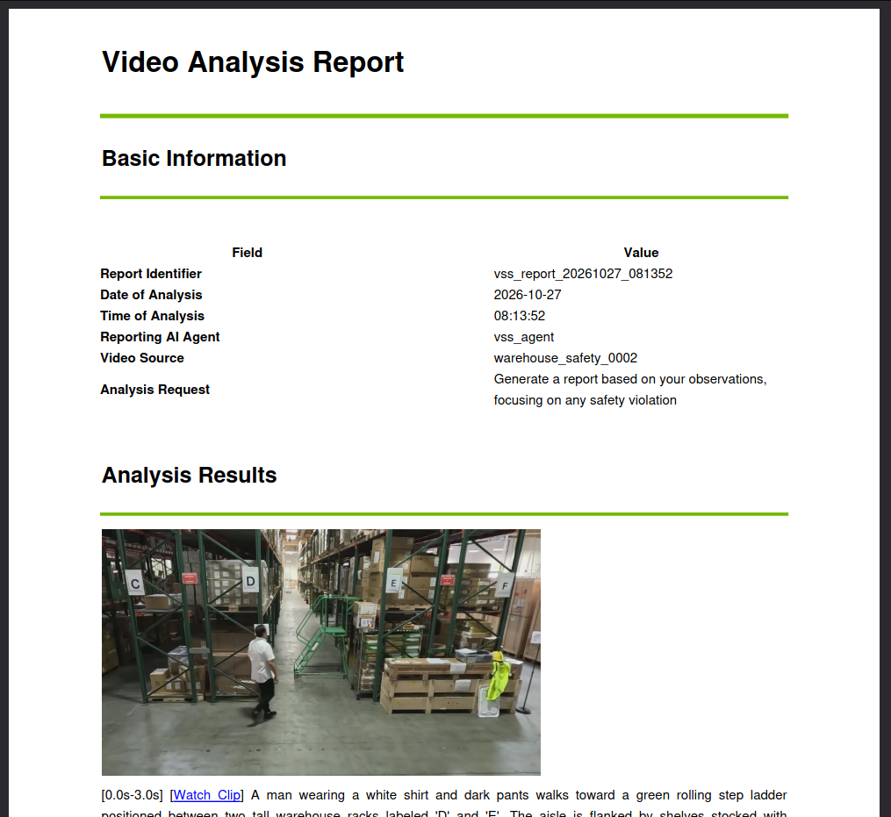

# Build a Video Search and Summarization (VSS) Agent

> Run the VSS Blueprint on your Spark

## Table of Contents

- [Overview](#overview)
- [Instructions](#instructions)
- [Troubleshooting](#troubleshooting)

---

## Overview

## Basic idea

Deploy NVIDIA's Video Search and Summarization (VSS) AI Blueprint to build intelligent video analytics systems that combine vision language models, large language models, and retrieval-augmented generation. The system transforms raw video content into real-time actionable insights with video summarization, Q&A, and real-time alerts. You'll set up either a completely local Event Reviewer deployment or a hybrid deployment using remote model endpoints.

## What you'll accomplish

You will deploy NVIDIA's VSS AI Blueprint on NVIDIA Spark hardware with Blackwell architecture, choosing between two deployment scenarios: VSS Event Reviewer (completely local with VLM pipeline) or Standard VSS (hybrid deployment with remote LLM/embedding endpoints). This includes setting up Alert Bridge, VLM Pipeline, Alert Inspector UI, Video Storage Toolkit, and optional DeepStream CV pipeline for automated video analysis and event review.

## What to know before starting

- Working with NVIDIA Docker containers and container registries
- Setting up Docker Compose environments with shared networks
- Managing environment variables and authentication tokens
- Basic understanding of video processing and analysis workflows

## Prerequisites

- NVIDIA Spark device with ARM64 architecture and Blackwell GPU
- DGX OS (suggested: 7.4.0 or higher)
- Driver version 580.95.05 or higher installed: `nvidia-smi | grep "Driver Version"`
- CUDA version 13.0 installed: `nvcc --version`
- Docker installed and running: `docker --version && docker compose version`
- Access to NVIDIA Container Registry with [NGC API Key](https://build.nvidia.com)
- NVIDIA Container Toolkit
- [Optional] NVIDIA API Key for remote model endpoints (hybrid deployment only)
- Sufficient storage space for video processing (>10GB recommended in `/tmp/`)

## Ancillary files

- [VSS Blueprint GitHub Repository](https://github.com/NVIDIA-AI-Blueprints/video-search-and-summarization) - Main codebase and Docker Compose configurations
- [VSS Official Documentation](https://docs.nvidia.com/vss/latest/index.html) - Complete system documentation

## Time & risk

* **Duration:** 30-45 minutes for initial setup, additional time for video processing validation
* **Risks:**
  * Container startup can be resource-intensive and time-consuming with large model downloads
  * Network configuration conflicts if shared network already exists
  * Remote API endpoints may have rate limits or connectivity issues (hybrid deployment)
* **Rollback:** Stop all containers with `deploy/docker/scripts/dev-profile.sh down`
* **Last Updated:** 27/10/2026
  * Update required OS and Driver versions
  * Support for VSS 3.3.0 with Cosmos Reason 3 VLM

## Instructions

## Step 1. Verify environment requirements

Check that your system meets the hardware and software [prerequisites](https://docs.nvidia.com/vss/latest/prerequisites.html).

```bash
## Verify driver version
nvidia-smi | grep "Driver Version"
## Expected output: Driver Version: 580.95.05 or higher

## Verify CUDA version
nvcc --version
## Expected output: release 13.0

## Verify Docker is running
docker --version && docker compose version
```

## Step 2. Configure Docker

To easily manage containers without sudo, you must be in the `docker` group. If you choose to skip this step, you will need to run Docker commands with sudo.
Open a new terminal and test Docker access. In the terminal, run:

```bash
docker ps
```

If you see a permission denied error (something like permission denied while trying to connect to the Docker daemon socket), add your user to the docker group so that you don't need to run the command with sudo .

```bash
sudo usermod -aG docker $USER
newgrp docker
```


Additionally, configure Docker so that it can use the NVIDIA Container Runtime.

```bash
sudo nvidia-ctk runtime configure --runtime=docker
sudo systemctl restart docker

##Run a sample workload to verify the setup
sudo docker run --rm --runtime=nvidia --gpus all ubuntu nvidia-smi
```

## Step 3. Clone the VSS repository

Clone the Video Search and Summarization repository from NVIDIA's public GitHub.

**NOTE** Install Git LFS if not already present on the system

```bash
sudo apt-get install -y git-lfs && git lfs install
```

```bash
## Clone the VSS AI Blueprint repository
git clone https://github.com/NVIDIA-AI-Blueprints/video-search-and-summarization.git
cd video-search-and-summarization
git checkout tags/v3.3.0
git lfs install
git lfs pull
```

## Step 4. Run the cache cleaner script

Start the system cache cleaner to optimize memory usage during container operations.

Create the cache cleaner script at /usr/local/bin/sys-cache-cleaner.sh mentioned below

```bash
sudo tee /usr/local/bin/sys-cache-cleaner.sh << 'EOF'
#!/bin/bash
## Exit immediately if any command fails
set -e

## Disable hugepages
echo "disable vm/nr_hugepage"
echo 0 | tee /proc/sys/vm/nr_hugepages

## Notify that the cache cleaner is running
echo "Starting cache cleaner - Running"
echo "Press Ctrl + C to stop"
## Repeatedly sync and drop caches every 3 seconds
while true; do
     sync && echo 3 | tee /proc/sys/vm/drop_caches > /dev/null
     sleep 3
done
EOF

sudo chmod +x /usr/local/bin/sys-cache-cleaner.sh
```
Running in the background

```bash
## In another terminal, start the cache cleaner script.
sudo -b /usr/local/bin/sys-cache-cleaner.sh
```

**NOTE**
The above runs the cache cleaner in the current session only; it does not persist across reboots. To have the cache cleaner run across reboots, create a systemd service instead. 
To stop the background cache cleaner:
```bash
sudo pkill -f sys-cache-cleaner.sh
```


## Step 5. Authenticate with NVIDIA Container Registry

Log in to NVIDIA's container registry using your NGC API Key.

1. Sign up/Log in to [NVIDIA Build](https://build.nvidia.com/)
2. Click your profile > **API Keys** and generate one
3. Copy and save your NGC API Key in somewhere safe

**NOTE** In production environment, ensure that NGC API Key is stored securely. It is also a good practice to refresh your API Key regularly.

```bash
## Log in to NVIDIA Container Registry
docker login nvcr.io
## Username: $oauthtoken
## Password: <PASTE_NGC_API_KEY_HERE>
```

## Step 6. Choose deployment scenario

Below are the deployment options for different scenario and use cases:

| Deployment Scenario                       | VLM (Cosmos-Reasoner3)| LLM                           | 
|-------------------------------------------|------------------------|-------------------------------|
| [Standard VSS deployment (Base)](https://docs.nvidia.com/vss/latest/quickstart.html#deploy)                      | Local                  | Remote                        |
| [Standard VSS deployment (Alert Verification)](https://docs.nvidia.com/vss/latest/agent-workflow-alert-verification.html)         | Local                  | Remote                        |
| [Standard VSS deployment (Real-Time Alerts)](https://docs.nvidia.com/vss/latest/agent-workflow-rt-alert.html#real-time-alert-workflow) | Local                  | Remote                        |

For our example, we will focus on the **Standard VSS (Base)**.

## Step 7. Launch VSS 

**[Standard VSS](https://docs.nvidia.com/vss/latest/#architecture-overview) (Hybrid Deployment)**

The Standard VSS (base) consists of a hybrid deployment. We would use NIMs from [build.nvidia.com](https://build.nvidia.com/). Alternatively, you can configure your own hosted endpoints by following the instructions in the [VSS remote LLM deployment guide](https://docs.nvidia.com/vss/latest/vss-agent/configure-llm.html).

### 7.1 Launch Standard VSS deployment

```bash
## Start Standard VSS (Base)

export NGC_CLI_API_KEY='your_api_key'
export NVIDIA_API_KEY='your_api_key'
export VSS_CONTAINER_TAG="3.3.0"
export LLM_ENDPOINT_URL=https://integrate.api.nvidia.com

deploy/docker/scripts/dev-profile.sh up -p base -H DGX-SPARK --use-remote-llm --llm nvidia/nemotron-3.5-lightning-30b-a3b
```

This step will take several minutes as containers are pulled and services initialize. The VSS backend requires additional startup time.

Set the following environment variables before deployment:
- **NGC_CLI_API_KEY** — (required) NGC API key for pulling images and deployment
- **NVIDIA_API_KEY** — Required For remote LLM/VLM endpoints
- **VSS_CONTAINER_TAG** — (required) Container image tag specifying the VSS version to deploy
- **LLM_ENDPOINT_URL** — (required when using `--use-remote-llm`) Base URL for the remote LLM
- **`--use-remote-llm`** — (required) Use a remote LLM, the base URL is read from **`LLM_ENDPOINT_URL`** in the environment
- **`--llm`** — (required) Remote LLM model name. Strongly recommended model: `nvidia/nemotron-3.5-lightning-30b-a3b`. Omitting --llm may cause the script to use whatever model is returned by the remote endpoint.


Run **`deploy/docker/scripts/dev-profile.sh --help`** for a full list of supported arguments.


**7.3 Validate Standard VSS deployment**

Open `http://localhost:7777` in your browser to access the Agent interface.



## Step 8. Test video processing workflow

Upload a video to verify the video analysis pipeline is functioning based on your deployment.

### 8.1 Download Sample Videos
```bash
wget --content-disposition https://api.ngc.nvidia.com/v2/resources/nvidia/ngc-apps/ngc_cli/versions/4.34.10/files/ngccli_arm64.zip -O ngccli_arm64.zip && unzip ngccli_arm64.zip

# Check the binary's md5 hash to ensure the file wasn't corrupted during download
find ngc-cli/ -type f -exec md5sum {} + | LC_ALL=C sort | md5sum -c ngc-cli.md5

# Check the binary's SHA256 hash to ensure the file wasn't corrupted during download
sha256sum ngccli_arm64.zip

# After verifying value, make the NGC CLI binary executable and add your current directory to path
chmod u+x ngc-cli/ngc
echo "export PATH=\"\$PATH:$(pwd)/ngc-cli\"" >> ~/.bash_profile && source ~/.bash_profile

ngc config set

# When prompted:
# Include your NGC API key 
# Enter CLI output format type: json
# Enter org: Press Enter
# Enter team: Press Enter

# Download sample data
ngc registry resource download-version nvidia/vss-developer/dev-profile-sample-data:3.3.0

EXTRACT_DIR="${PWD}/sample-data"
mkdir -p "${EXTRACT_DIR}"
tar -xf dev-profile-sample-data_v3.3.0/dev-profile-sample-data.tar.gz -C "${EXTRACT_DIR}"

rm -rf dev-profile-sample-data_v3.3.0
```

### 8.2 Upload Sample Videos to VSS

1. From VSS app, either drag and drop sample videos, or left-click on the icon and select one of the videos you have just downloaded. For this example, we will use `warehouse_safety_0002.mp4`.



2. Click `+Chat` button in the tile and on the right, start chatting. Ask a prompt similar to: `What time did the worker climb up the ladder?`



3. Also ask prompt similar to: `Is the worker wearing any safety PPE?`



4. Lastly, get VSS to generate a report. Ask prompt similar to: `Generate a report based on your observations, focusing on any safety violation`. A confirmation screen appears asking for your confirmation on the template of the report. Click `Submit`



5. After the report is prepared, click PDF Report. The report will be ready for saving.



6. Inspect the pdf report. Not getting the results you were expecting? Prompt VSS to generate the report again, this time focusing on giving clearer instructions in your prompt!




## Step 9. Cleanup and rollback

To completely remove the VSS deployment and free up system resources, follow the steps below:

> [!WARNING]
> This will destroy all processed video data and analysis results.

```bash
## For Standard VSS deployment
deploy/docker/scripts/dev-profile.sh down
```

## Step 10. Next steps (Optional)

You can optionally experiment with other types of VSS scenarios. You would need to remove your current VSS and redeploy one of the scenarios below.

```bash

## Start Standard VSS (Alert Verification)
export NGC_CLI_API_KEY='your_ngc_api_key'
export NVIDIA_API_KEY='your_ngc_api_key'
export VSS_CONTAINER_TAG="3.3.0"
export LLM_ENDPOINT_URL=https://integrate.api.nvidia.com

deploy/docker/scripts/dev-profile.sh up -p alerts -m verification -H DGX-SPARK --use-remote-llm --llm nvidia/nemotron-3.5-lightning-30b-a3b


## Start Standard VSS (Real-Time Alerts)
export NGC_CLI_API_KEY='your_ngc_api_key'
export NVIDIA_API_KEY='your_ngc_api_key'
export VSS_CONTAINER_TAG="3.3.0"
export LLM_ENDPOINT_URL=https://integrate.api.nvidia.com

deploy/docker/scripts/dev-profile.sh up -p alerts -m real-time -H DGX-SPARK --use-remote-llm --llm nvidia/nemotron-3.5-lightning-30b-a3b

```

## Troubleshooting

| Symptom | Cause | Fix |
|---------|--------|-----|
| Container fails to start with "pull access denied" | Missing or incorrect nvcr.io credentials | Re-run `docker login nvcr.io` with valid credentials |
| Web interfaces not accessible | Services still starting or port conflicts | Wait 2-3 minutes, check `docker ps` for container status |


NOTE: DGX Spark uses a Unified Memory Architecture (UMA), which enables dynamic memory sharing between the GPU and CPU. 
With many applications still updating to take advantage of UMA, you may encounter memory issues even when within 
the memory capacity of DGX Spark. If that happens, manually flush the buffer cache with:
```bash
sudo sh -c 'sync; echo 3 > /proc/sys/vm/drop_caches'
```
